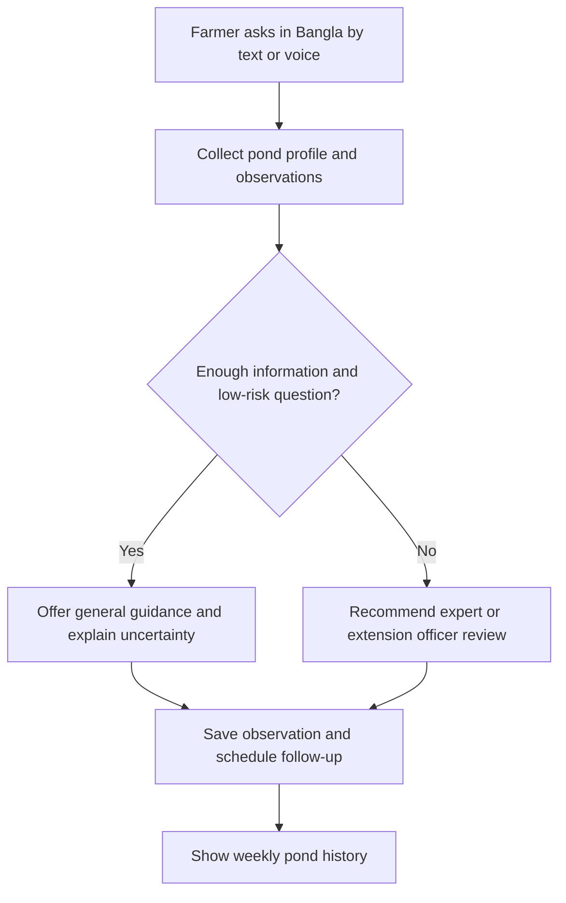

# AI product concept for fish farming

A concept case study for a Bangla-first digital companion that helps fish farmers learn basic pond practices and organize observations during a production cycle.

## Farmer experience

1. A beginner learns through short interactive lessons and a simple pond setup game.
2. A farmer creates a pond profile with species, stocking date, and routine observations.
3. The companion asks guided questions about feeding, water appearance, fish behavior, and recent changes.
4. It gives a clearly labeled general suggestion or helps the farmer contact an extension officer or expert.
5. Weekly summaries make observations easier to discuss during follow-up.

## Support flow

## Product safeguards

- Ask for context before suggesting next steps and keep the language accessible.
- Show when guidance is general and when an expert should assess the pond.
- Avoid diagnosing disease or recommending medication from a photo alone.
- Let the farmer correct or remove observations and request a human review.
- Use weather information as context, not as a guarantee of pond conditions.

## Example concept screen

**Pond: Demo Pond 01**  
Species: Tilapia · Stocking: 30 days ago  
Today’s observation: Fish are eating less than usual  
Next step: Record water color, oxygen/aeration conditions, recent weather, and feeding amount. If the change continues or fish show distress, contact a local fisheries officer or qualified expert.

This is a product concept, not a deployed AI service or aquaculture treatment protocol. It uses no real farm or farmer data.
